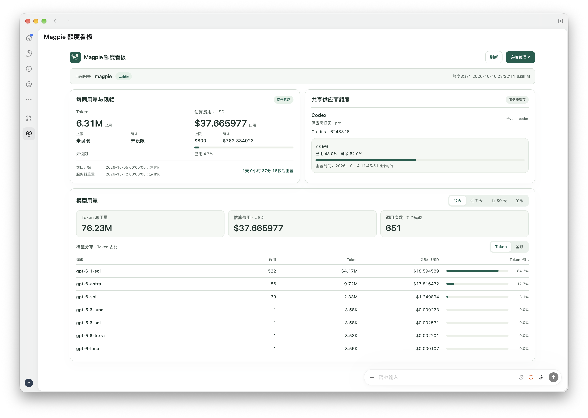

# Magpie 额度看板

在 Codex 中查看**远程 Magpie 服务**的个人额度、模型用量和共享供应商额度。插件后台运行在本机，数据来自你连接的远程服务器；本机无需安装 Magpie，也无需自行构建插件。



## 添加市场与安装插件

**运行要求：** macOS 13+（Apple Silicon / Intel）或 Windows 11 x64。请先安装 Node.js：macOS 需要 22.13.0+；Windows 需要 22.13.0+ 且内置 libuv 1.51.0+，例如 Node.js 22.17.0。

1. 打开 Codex 插件页，选择「添加插件市场」，填写：

   | 字段 | 内容 |
   | --- | --- |
   | 来源 | `PennyVibe/magpie-quota-plugin` |
   | Git 引用 | `main` |
   | 稀疏路径 | 留空 |

2. 添加后进入「Magpie 额度看板」市场，安装并启用「Magpie 额度看板」插件。

支持插件命令的 Codex CLI 也可使用：

```sh
codex plugin marketplace add PennyVibe/magpie-quota-plugin --ref main
codex plugin add magpie-quota-local@magpie-local
```

市场标识为 `magpie-local`，插件 ID 为 `magpie-quota-local`。已添加同名市场时沿用原来源，无需重复添加。私有仓库需要本机 Git 已有读取权限。

## 首次连接

1. 在插件入口打开「Magpie 额度看板」，或在聊天中说「打开 Magpie 额度看板」。
2. 点击「连接管理」，在本机浏览器中填写连接名称、远程 Magpie 服务地址和服务器分配的 Gateway key。
3. 点击「保存连接」，验证成功后返回看板，点击「完成，读取当前连接」。

服务地址可填写 `https://example.com/magpie-gateway` 或带 `/v1` 的地址。不要把 Gateway key 发到聊天中；它只在本机连接页填写，并以**未加密的明文 JSON**保存在本机。建议使用 HTTPS。

看板可切换今天、近 7 天、近 30 天和全部的模型用量，可见时每 60 秒刷新，也支持手动刷新。共享供应商额度默认展示，不代表当前 Key 的个人用量；服务器不支持个人用量或无法确认统计范围时，看板会明确提示。

## 开发

使用上述兼容的 Node.js，在仓库根目录执行：

```sh
npm ci
npm test
npm run typecheck
npm run lint
npm run build
npm run local:package
npm run local:verify
node scripts/verify-package.mjs
npm run marketplace:sync
npm run marketplace:check
npm run marketplace:verify
```

修改源码后重复以上流程，可跳过 `npm ci`（依赖未变时）。`local/` 是本机后台与连接页，`lib/` 是接口解析与 MCP 工具，`widget/` 是看板界面。

构建与打包产物在 `dist/`。`marketplace:sync` 将运行文件和文档同步到 `plugins/magpie-quota-local/`，使 GitHub 市场可直接安装。提交变更时须包含同步后的文件；不要手改 `generated/`、`dist/` 或插件的 `server/` 生成文件。

界面预览：构建后运行 `npm run ui:preview`，打开终端输出的地址。预览使用合成数据，不保存连接、不访问真实网关。测试同样只使用合成 Key / mock；真实宿主、远端服务和 Windows 实机需另行验证。

真实数据开发预览：

```sh
npm run ui:dev
```

打开终端输出的完整地址。入口读取插件已保存的当前连接，监听 `widget/`、`local/`、`lib/` 和插件图标的代码变更；保存后自动重建后台并刷新浏览器，无需手动运行 build。构建失败时保留上一版页面，修复保存后自动恢复。开发产物写入独立临时目录，不覆盖 `generated/`、`dist/` 或已安装插件。停止服务按 `Ctrl+C`；添加或切换连接仍从已安装插件的「连接管理」进入。

详细说明见 [接口契约](docs/upstream-contract.md) 和 [验证记录](docs/validation.md)。
